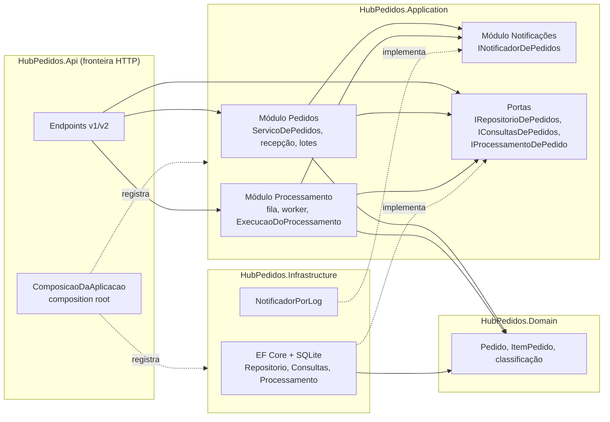

# Roteiro 6 — Modularização, IoC, fronteiras e versionamento compatível de APIs

**Objetivo:** separar responsabilidades do Hub e evoluir o contrato HTTP sem romper um
cliente que depende da versão anterior.

## Como executar

```bash
dotnet test
dotnet run --project src/HubPedidos.Api --launch-profile http
```

| Rota | Versão |
|---|---|
| `GET /api/pedidos/{id}` | v1 (versão ausente = padrão), com cabeçalhos de depreciação |
| `GET /api/v1/pedidos/{id}` | v1 explícita |
| `GET /api/v2/pedidos/{id}` | v2 |
| `GET /api/v3/pedidos/{id}` (ou qualquer outra) | 400 + `api-supported-versions: 1, 2` |
| `GET /openapi/v1.json`, `GET /openapi/v2.json` | Documentos OpenAPI separados por versão |

## Módulos e direção das dependências (etapa 1)



As setas sólidas são dependências de compilação; as tracejadas, "implementa" e "registra".
Nenhuma seta sai do Domain, e a Application não aponta para fora. A direção é verificada
por testes, não só pelo diagrama (ver `Arquitetura/DependenciasTestes`).

| Módulo | Responsabilidade | Portas que consome | Implementação |
|---|---|---|---|
| Pedidos | Recepção, classificação, criação, cancelamento, consultas, lotes | `IRepositorioDePedidos`, `IConsultasDePedidos`, `INotificadorDePedidos` | `RepositorioDePedidos`, `ConsultasDePedidos` (EF) |
| Processamento | Fila limitada, worker, limite de acesso ao banco | `IProcessamentoDePedido`, `INotificadorDePedidos` | `ProcessamentoDePedidoEfCore` |
| Notificações | Publicar mudança de situação depois de persistida | — (é a própria porta) | `NotificadorPorLog` (Roteiro 7: SignalR) |

Decisões arquiteturais registradas, com as alternativas descartadas:
[ADR 0001](../adr/0001-modulos-e-direcao-das-dependencias.md) (módulos e portas),
[ADR 0002](../adr/0002-composition-root-e-tempos-de-vida.md) (composition root e tempos de vida),
[ADR 0003](../adr/0003-versionamento-da-consulta-de-pedido.md) (versionamento).

## IoC (etapa 2)

- **Registros por módulo:** `AddModuloPedidos` e `AddModuloProcessamento` (Application),
  `AddPersistenciaDePedidos` e `AddNotificacoesPorLog` (Infrastructure).
  `ComposicaoDaAplicacao.ConfigurarServicos` é o composition root; o `Program` só o chama
  e mapeia as rotas.
- **Tempos de vida revisados:** tabela completa na ADR 0002. Em resumo, singletons para
  estado compartilhado e seguro (fila, métricas, limitador, catálogo); scoped para tudo
  que toca o DbContext e para os casos de uso; nenhum transient.
- **Sem service locator na regra de negócio:** `ServicoDePedidos` e
  `ExecucaoDoProcessamento` recebem tudo por construtor. O worker é o único que usa o
  contêiner diretamente, para criar um escopo por item, e resolve um único ponto de entrada.
- **Validação do grafo:** `ValidateOnBuild` e `ValidateScopes` ficam ligados em todos os
  ambientes. O teste de inicialização usa o mesmo composition root, e uma contraprova
  mostra que um singleton dependendo de um serviço scoped é barrado.

## Política de versão (etapa 3)

- **Endpoint escolhido:** consulta de pedido por id. Consumidores conhecidos: o front-end
  do painel e as integrações de lojistas.
- **Leitura da versão:** segmento da URL. Versão ausente vale v1 (padrão); versão não
  suportada recebe 400 + `api-supported-versions`.
- **v1 sem alteração:** mesmo corpo, mesmos nomes, mesmos tipos. Ganhou apenas cabeçalhos
  de ciclo de vida.
- **v2:** gerada pelo adaptador anticorrupção `AdaptadorDePedidoV2` a partir da mesma
  representação interna: um domínio, um serviço, uma consulta.

### Matriz de mudanças v1 → v2

| Campo v1 | v2 | Tipo de mudança | Impacto em um cliente v1 se fosse feita na v1 |
|---|---|---|---|
| `clienteId` (texto) | `cliente.id` | Renomeado e aninhado | Campo some: nome do cliente não aparece |
| `valorTotal` (número) | `valor { quantia, moeda }` | Forma mudou | Leitura de número falha (lojistas) |
| `regiao`, `prioridade`, `endereco` | `entrega { regiao, prioridade, endereco }` | Agrupado | Campos somem do nível raiz |
| `situacao` ("Recebido") | `situacao` ("recebido") | Semântica de formato | Comparações exatas deixariam de casar |
| `itens[].precoUnitario`, `subtotal` (números) | objetos de dinheiro | Forma mudou | Somas no cliente falham |
| `motivoDaCategoria`, `processador`, `prazoEstimadoEmDias`, `quantidadeDeItens` | removidos | Remoção | Campos somem |
| — | `previsaoDeEntrega` (data ou `null`) | Adição | Compatível (opcional; `null` quando cancelado) |
| `criadoEmUtc` | `criadoEm` | Renomeado | Campo some |

### Ciclo de vida (etapa 4.3–4.4)

A v1 responde com `Deprecation: @1793836800` (anúncio em 2026-11-05, RFC 9745),
`Sunset: Fri, 31 Dec 2027 23:59:59 GMT` (data demonstrativa, RFC 8594) e
`Link: </api/v2/pedidos/{id}>; rel="successor-version"`. O uso por versão é medido pelo
contador `hubpedidos.api.consulta_pedido.chamadas`, com as tags `versao` e `implicita`. Os
critérios de retirada estão na [ADR 0003](../adr/0003-versionamento-da-consulta-de-pedido.md):
menos de 1% de uso por 30 dias, migração confirmada, aviso com 6 meses de antecedência e
`410 Gone` antes da remoção.

## Extensões ("Aprimoramentos")

- **Teste arquitetural automatizado entre assemblies** (`DependenciasTestes`): a
  infraestrutura não referencia a API; os endpoints não usam tipos da Infrastructure nem do
  EF Core em parâmetros ou retornos; cada porta da aplicação tem implementação só na
  infraestrutura. Somam-se aos testes do Roteiro 1 (Domain e Application).
- **Adaptador anticorrupção** entre as duas representações de pedido (`AdaptadorDePedidoV2`).

## Correções de roteiros anteriores

- **Consulta compilada (Roteiro 3):** um delegate estático único quebrou quando vários
  hosts de teste criaram modelos EF distintos no mesmo processo ("Compiled queries can only
  be used with a single model"). É a restrição que o guia do Roteiro 3 tinha registrado.
  Agora há um delegate por modelo (`ConditionalWeakTable<IModel, ...>`); em produção há um
  único modelo, então o ganho medido não muda.
- **Experimento de backpressure (Roteiro 4):** o contêiner montado à mão no experimento
  passou a registrar `ExecucaoDoProcessamento`. Rodei de novo para conferir (A: 352
  processados, B: 997).

## Testes obrigatórios do relatório

| Teste obrigatório (Relatório, Atividade 6) | Onde está |
|---|---|
| Camada de domínio compila sem referência à API ou EF Core | `DependenciasTestes.Dominio_nao_referencia_nenhum_outro_projeto_nem_framework_web`, `Aplicacao_nao_referencia_API_ASPNET_nem_infraestrutura`, `Endpoints_dependem_so_de_portas...` |
| Nenhum serviço scoped é capturado por singleton | `ComposicaoTestes.Composition_root_constroi_o_grafo_sem_dependencia_cativa` (grafo real com `ValidateScopes`) e `Validacao_detecta_scoped_capturado_por_singleton` (contraprova) |
| v1 e v2 coexistem e produzem contratos documentados | `VersionamentoTestes.V1_tem_contrato_estavel...`, `V2_tem_o_contrato_novo...`, `OpenAPI_e_separado_por_versao` |
| Cliente v1 interpreta a resposta sem mudança silenciosa de semântica | `Cliente_v1_continua_funcionando_na_aplicacao_que_tambem_tem_v2` (fixture `ClienteFrontEndV1` com sua própria cópia do contrato) |
| Versão ausente ou não suportada segue política explícita e testada | `V1_tem_contrato_estavel...` (sem versão = v1, mesmo corpo) e `Versao_nao_suportada_segue_politica_explicita` (v0, v3, v99) |
| Tempos de vida justificados | `Tempos_de_vida_seguem_o_estado_de_cada_servico` + ADR 0002 |

## Evidências de execução manual

API em Development:

- `POST /api/pedidos` → 201; o log registrou `Pedido ... mudou para Recebido` (módulo de
  notificações).
- `GET /api/pedidos/{id}` → 200 com `Deprecation: @1793836800`,
  `Sunset: Fri, 31 Dec 2027 23:59:59 GMT`, `Link: </api/v2/pedidos/{id}>; rel="successor-version"`
  e `api-supported-versions: 1, 2`.
- `GET /api/v2/pedidos/{id}` → `{"cliente":{"id":...},"situacao":"recebido","valor":{"quantia":21,"moeda":"BRL"},"entrega":{...},"previsaoDeEntrega":"2026-11-07",...}`.
- `GET /api/v3/pedidos/{id}` → 400 "A versão 3 da API não é suportada. Versões suportadas: 1, 2."
- `/openapi/v1.json` lista as rotas v1 (inclusive `/api/v1/pedidos/{id}`); `/openapi/v2.json`
  lista apenas `/api/v2/pedidos/{id}`.

## Versões utilizadas

| Item | Versão |
|---|---|
| Microsoft.AspNetCore.OpenApi | 10.0.13 |
| Microsoft.AspNetCore.Mvc.Testing | 10.0.13 (só no projeto de testes) |
| SDK / runtime | .NET 10.0.401 / 10.0.12 |
| Testes | 159 aprovados (13 novos neste roteiro), 3 execuções seguidas sem falha |
